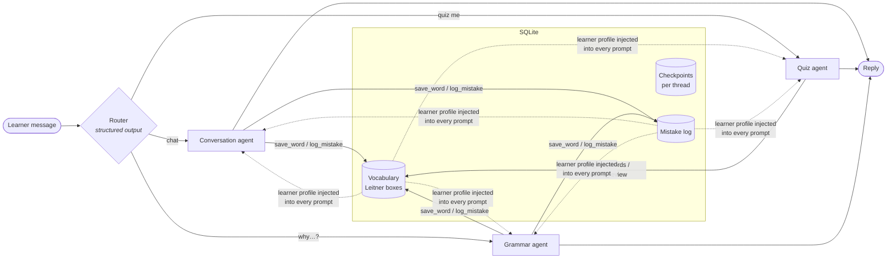

# Lena: a multi-agent German tutor

[](https://github.com/NilaRavi97/Language-Learning-Agent/actions/workflows/tests.yml)

A conversational German tutor built with **LangGraph** and **LangChain** on Google Gemini.
A router sends each message to one of three specialist agents. The tutor remembers your
vocabulary through **spaced repetition**, tracks your **recurring grammar mistakes**, and
uses them to shape later lessons. Conversations persist across sessions.



## Features

| | |
|---|---|
| **Routing** | A `StateGraph` router classifies each message (`RouteDecision` Pydantic model via `with_structured_output`) using the recent transcript. A quiz answer like *"die Tür"* therefore stays in the quiz. |
| **Specialist sub-agents** | Three `create_agent` ReAct agents. Each has its own prompt and a minimal set of tools. |
| **Spaced repetition** | Leitner system with 5 boxes and review intervals of 1/2/4/8/16 days. A correct answer moves a word up a box; a wrong one sends it back to box 1. |
| **Adaptive prompts** | `@dynamic_prompt` middleware renders a live learner profile (vocabulary stats and most frequent mistake categories) into the system prompt on every model call. |
| **Persistent memory** | `SqliteSaver` checkpoints every thread. Restart the app and the conversation continues. |
| **Bounded context** | `@wrap_model_call` middleware trims each model request to the last *N* messages and never splits a tool call from its result. The full history stays in the checkpoint. |
| **Resilience** | A router failure falls back to conversation. Optional client-side rate limiting (`TUTOR_RPM`) keeps usage within the free tier. A turn that fails on an API error is rolled back so the saved thread stays consistent. |
| **Tested offline** | The pytest suite uses scripted fake chat models, so CI needs no API key. |

## Example session

```text
You: Ich habe gestern ins Kino gegangen.
   💬 routed to: conversation
   🔧 log_mistake(category='perfekt with sein', wrong='Ich habe gestern ins Kino gegangen.', ...)

Lena: ✏️ Correction: Ich bin gestern ins Kino gegangen.
💡 Why: Verbs that express movement from one place to another (like gehen) use sein
instead of haben in the Perfekt tense.
Das klingt nach einem schönen Abend! Welchen Film hast du im Kino gesehen?

You: Quiz me please
   🧠 routed to: quiz
   🔧 get_due_words()

Lena: Super, los geht's mit dem Quiz! 🎯  Wie heißt "door" auf Deutsch? (Bitte mit Artikel)

You: die Tür
   🧠 routed to: quiz
   🔧 record_review(word_id=1, correct=True)

Lena: Richtig! Die Tür ist korrekt. ✅  Nächste Frage: Wie heißt "apple" auf Deutsch?

You: Why do some verbs use sein in the Perfekt?
   📐 routed to: grammar

Lena: … 💡 Note: This connects directly to your earlier sentence "Ich habe gestern ins
Kino gegangen" …
```

## Quick start

```bash
python -m venv .venv
.venv\Scripts\activate            # Windows  (source .venv/bin/activate on macOS/Linux)
pip install -e ".[dev]"

cp .env.example .env              # add your GEMINI_API_KEY

python -m german_tutor --import-json examples/words.json   # optional starter vocabulary
python -m german_tutor                                       # start chatting
```

| Command | |
|---|---|
| `python -m german_tutor --level B1` | Set the CEFR level (A1–C2) |
| `python -m german_tutor --thread travel` | Use a named, persistent conversation |
| `python -m german_tutor --new` | Start a fresh thread |
| `python -m german_tutor --stats` | Show vocabulary and mistake statistics |
| `python -m german_tutor --quiet` | Hide routing and tool-call traces |

On the Gemini free tier (5 requests per minute), set `TUTOR_RPM=5`. Each turn makes 2–4 model calls.

## Project layout

```text
german_tutor/
  graph.py     StateGraph: router + three create_agent specialists, middleware
  tools.py     LangChain tools, built by a factory bound to a VocabStore
  store.py     SQLite: vocabulary (Leitner SRS) and mistake log, thread-safe
  prompts.py   System prompts, rendered with the live learner profile
  config.py    Settings from environment variables
  cli.py       Interactive chat loop
tests/         pytest suite with scripted fake models (no API calls)
examples/      The project's evolution: raw API call → chat → prompt → single tool agent
```

## Running tests

```bash
pytest -q
```

## Possible extensions

- Voice mode (speech-to-text in, TTS out) for pronunciation practice
- A web UI with LangGraph streaming (`stream_mode="messages"`)
- A placement test that sets the CEFR level automatically
- An LLM-as-judge evaluation set for correction quality
